# 🛡️ Awesome Connected App Security

  

  
  
  
  
  
  

---

## 📌 Top Connected App Security Ecosystem

> **Curated Index of SaaS Platforms & Open-Source Projects for OAuth Governance, SaaS Supply Chain Risk, SSPM & Zero Trust Architecture.**  
> *Last updated: March 2026*

Third-party integrations, OAuth grants, and SaaS add-ons introduce massive blind spots into corporate environments. Compromised API tokens, over-permissioned OAuth applications, and shadow SaaS integrations regularly lead to silent account takeovers and supply chain breaches. 

This repository provides an authoritative, SEO-indexed directory tracking enterprise **SaaS Security Solutions** and battle-tested **Open-Source GitHub Projects**. Security architects, DevSecOps practitioners, and SaaS administrators can use these tools to discover, audit, revoke, and continuously monitor connected apps and integrations across Salesforce, Google Workspace, Microsoft 365, Slack, GitHub, Jira, and internal zero-trust networks.

---

## 📖 Table of Contents

- [📊 Sector Overview & Market Dynamics](#-sector-overview--market-dynamics)
- [☁️ Enterprise SaaS & Hosted Platforms](#️-enterprise-saas--hosted-platforms)
- [🔓 Open-Source GitHub Projects](#-open-source-github-projects)
- [🛠️ Architecture: Custom Self-Hosted Stack](#️-architecture-custom-self-hosted-stack)
- [⭐ Star History](#-star-history)
- [🤝 Support](#-support)
- [🤝 How to Contribute](#-how-to-contribute)
- [⚖️ Disclaimer](#️-disclaimer)

---

## 📊 Sector Overview & Market Dynamics

The **SaaS Security Posture Management (SSPM) and Connected App Security** sector is experiencing accelerated growth, with market size estimates expanding from **$480M–$2.3B in 2024–2025 to over $3.5B–$7.5B by 2030–2032** at an estimated CAGR of **16% to 28%** (with the broader application security ecosystem exceeding $16B+). 

The market is currently **moderately fragmented but undergoing rapid consolidation** into a platform-centric model; early standalone SSPM innovators are steadily being acquired by enterprise cloud security conglomerates (e.g., CrowdStrike acquiring Adaptive Shield, Palo Alto Networks and Microsoft embedding OAuth governance into CASB/CNAPP suites) to eliminate siloed point tools and deliver unified Zero Trust access.

---

## ☁️ Enterprise SaaS & Hosted Platforms

The following enterprise platforms provide managed OAuth token discovery, posture management, CASB capabilities, and zero-trust access enforcement. Sorted by company scale (market cap / valuation descending):

| Product | Company Valuation / Revenue | Pricing (Starting Tier) | Free Tier / Trial Limits | Key Connected App Security Capabilities |
| :--- | :--- | :--- | :--- | :--- |
| **[Microsoft Defender for Cloud Apps](https://www.microsoft.com/en-us/security/business/cloud-app-security)** | **~$3.88 Trillion** Market Cap (~$331.8B FY26 Revenue) | **$3.50** / user / month (commercial standalone license; also bundled in M365 E5) | **30-day free trial** (available via Microsoft 365 E5 evaluation tenant with full enterprise CASB features) | Comprehensive CASB with OAuth app governance, anomaly detection for token abuse, risk scoring of 30,000+ cloud apps, and automated session revocation. |
| **[Palo Alto Prisma Access](https://www.paloaltonetworks.com/prisma/access)** | **~$265.5 Billion** Market Cap (~$11.5B FY26 Revenue) | **$110.00** / user / year (~$9.17 / user / month baseline remote user tier; enterprise quote-based) | **Sales-guided PoC** (Proof of Concept access typically granted for 14 to 30 days via partner sales request) | Cloud-delivered SASE combining ZTNA 2.0, next-gen CASB, API-based SaaS inspection, and connected third-party integration threat prevention. |
| **[Salesforce Connected App Management](https://help.salesforce.com/)** | **~$218.5 Billion** Market Cap (~$41.5B FY26 Revenue) | **$25.00** / user / month (Salesforce Platform Starter; native admin tooling included) | **Free forever Developer Edition** (includes connected app manager, OAuth scopes, and sandbox; standard commercial trial is 30 days) | Native OAuth policies, IP allowlisting, refresh token rotation, JWT bearer token flow controls, External Client App governance, and permission-set scoping. |
| **[Cloudflare Zero Trust](https://www.cloudflare.com/zero-trust/)** | **~$121.5 Billion** Market Cap (~$2.17B FY25 Revenue) | **$7.00** / user / month (Pay-as-you-go Standard tier) | **Free forever plan** for up to **50 users** (includes ZTNA, Secure Web Gateway, 2 read-only CASB integrations, and 24-hour log retention) | Identity-aware reverse proxy (Access), SWG, WARP device posture, and CASB API integration scanning to govern SaaS access and enforce Zero Trust policies. |
| **[Zscaler Private Access](https://www.zscaler.com/)** | **~$38.1 Billion** Market Cap (~$3.35B FY26 Revenue) | **$140.00** / user / year (~$11.67 / user / month baseline ZPA tier; sold via annual subscription) | **Sales-guided 7-day hosted interactive test drive** / customized Proof of Concept upon enterprise request | Zero-Trust Network Access (ZTNA) replacing corporate VPNs with continuous least-privilege verification, app micro-segmentation, and inline inspection. |
| **[Netskope](https://www.netskope.com/)** | **~$7.25 Billion** Market Cap (~$709M FY26 Revenue, $811M ARR) | **$4.00** / user / month (Base module starting tier; modular enterprise subscription) | **14-day free test drive** (hands-on turnkey testing environment for Private Access and Cloud Exchange) | Inline and API-based CASB discovering sanctioned and shadow SaaS applications, connected GenAI plugins, OAuth integrations, and real-time DLP. |
| **[AppOmni](https://www.appomni.com/)** | **~$515 Million** Valuation ($123M Total Venture Funding) | **$75.00** / user / year ($7,500 per 100-user block per SaaS app via AWS Marketplace baseline) | **90-day free trial** for AppOmni Foundations; also offers free SaaS Maturity & Salesforce Security Assessments | Deep SaaS Security Posture Management (SSPM) inspecting OAuth permissions, API tokens, third-party integrations, and misconfigurations across M365, Salesforce, and ServiceNow. |
| **[Adaptive Shield](https://www.adaptive-shield.com/)** *(CrowdStrike Falcon Shield)* | **~$300 Million** Valuation (Acquired by CrowdStrike) | **$30.00** / user / year (Estimated baseline quote; enterprise custom pricing) | **Guided Proof of Concept (PoC)** (Typically 14 to 30 days coordinated through CrowdStrike enterprise sales) | Full-lifecycle SSPM monitoring connected app discovery, OAuth permission grants, shadow integrations, GenAI application safety, and automated policy remediation. |
| **[Wing Security](https://www.wing.security/)** | **~$75 Million** Valuation ($26M Total Venture Funding) | **$1,500.00** / year flat (SSPM for Compliance entry tier; higher tiers quote-based) | **Free forever SaaS Discovery Plan** (discovers entire SaaS inventory, third-party connected apps, shadow IT, and risk scores across users and devices) | Automated SaaS-to-SaaS integration discovery, OAuth permission analysis, risk tiering, and one-click revocation workflows for compromised tokens. |
| **[Spin.AI](https://spin.ai/)** *(SpinOne)* | **~$65 Million** Valuation ($18M+ Total Funding / K1-backed) | **$3.00** / user / month (SpinOne baseline protection tier; minimum annual commitment applies) | **15-day free trial** with full platform capabilities; also offers a free Google Workspace Extension Risk assessment tool | SaaS security platform specializing in automated OAuth app risk assessments, Chrome browser extension inspection, ransomware response, and DLP. |

---

## 🔓 Open-Source GitHub Projects

Curated open-source repositories for self-hosting zero-trust access proxies, OAuth identity providers, SaaS posture assessment engines, secret scanners, and runtime monitors. Sorted by GitHub stargazers (descending):

- **[trivy](https://github.com/aquasecurity/trivy)**   
  Comprehensive security scanner for container images, file systems, Git repositories, virtual machine images, and SaaS misconfigurations (Apache-2.0).

- **[keycloak](https://github.com/keycloak/keycloak)**   
  Open-source Identity and Access Management solution supporting OAuth 2.0, OpenID Connect, fine-grained client authorization, and user federation (Apache-2.0).

- **[vault](https://github.com/hashicorp/vault)**   
  Identity-based secrets and encryption management system for dynamic OAuth tokens, certificates, and API credentials (BUSL-1.1).

- **[authelia](https://github.com/authelia/authelia)**   
  Open-source authentication and authorization server providing two-factor authentication, single sign-on (SSO), and forward-auth middleware for reverse proxies (Apache-2.0).

- **[trufflehog](https://github.com/trufflesecurity/trufflehog)**   
  High-performance secret scanner searching for leaked connected app tokens, OAuth client secrets, and private keys across git and cloud environments (AGPL-3.0).

- **[pangolin](https://github.com/fosrl/pangolin)**   
  Open-source SASE platform built on WireGuard providing zero-trust VPN, identity-aware reverse proxy, and privileged access management (AGPL-3.0).

- **[server](https://github.com/bitwarden/server)**   
  Open-source credential and secrets management backend (AGPL-3.0) providing secure storage for connected app API keys and OAuth secrets.

- **[hydra](https://github.com/ory/hydra)**   
  Hardened OpenID Connect Certified and OAuth 2.0 authorization server used for securing third-party app connections and API access flows (Apache-2.0).

- **[zitadel](https://github.com/zitadel/zitadel)**   
  Cloud-native identity infrastructure and access management platform with OAuth 2.0, OIDC, passwordless authentication, and multi-tenancy (Apache-2.0).

- **[oauth2-proxy](https://github.com/oauth2-proxy/oauth2-proxy)**   
  Reverse proxy and middleware handling authentication using OAuth 2.0 / OIDC providers to protect upstream connected applications (MIT).

- **[prowler](https://github.com/prowler-cloud/prowler)**   
  Multi-cloud security posture assessment and compliance tool covering AWS, Azure, GCP, and Kubernetes with 300+ security checks (Apache-2.0).

- **[kubescape](https://github.com/kubescape/kubescape)**   
  Kubernetes open-source security platform (CNCF Sandbox / Apache-2.0) assessing risk, compliance, RBAC, and workload vulnerabilities.

- **[dex](https://github.com/dexidp/dex)**   
  OpenID Connect and OAuth 2.0 identity provider acting as a pluggable authentication gateway to LDAP, SAML, and OAuth providers (Apache-2.0).

- **[falco](https://github.com/falcosecurity/falco)**   
  Cloud-native runtime security tool (CNCF Graduated / Apache-2.0) for detecting anomalous application and connected container behaviors.

- **[cloud-custodian](https://github.com/cloud-custodian/cloud-custodian)**   
  Rules engine for cloud security governance, compliance, and automated remediation across cloud accounts and connected services (Apache-2.0).

- **[pomerium](https://github.com/pomerium/pomerium)**   
  Identity-aware reverse proxy implementing zero-trust access to internal and connected applications with continuous contextual authorization (Apache-2.0).

- **[octelium](https://github.com/octelium/octelium)**   
  Zero-trust secure access platform operating as remote access VPN, ZTNA, API/MCP gateway, and PaaS with OpenTelemetry-native auditing (Apache-2.0).

- **[KubeArmor](https://github.com/accuknox/KubeArmor)**   
  Runtime security enforcement engine (CNCF Sandbox / Apache-2.0) powering AccuKnox CNAPP with MCP server sandboxing and GenAI application protection.

- **[foxnode-aspm](https://github.com/valinorintelligence/foxnode-aspm)**   
  Application Security Posture Management platform with 16+ security tool parsers, AI finding triage, and compliance mapping to OWASP, SOC 2, and ISO 27001.

- **[ClosedSSPM](https://github.com/PiotrMackowski/ClosedSSPM)**   
  Open-source SaaS Security Posture Management CLI in Go auditing connected apps and SaaS configurations across Jira, Microsoft 365, and GitHub.

---

## 🛠️ Architecture: Custom Self-Hosted Stack

Security teams building vendor-independent connected application protection pipelines can compose a modular open-source defense stack:

1. **Identity & OAuth Token Brokerage**: Deploy **Keycloak** or **ORY Hydra** for centralized OpenID Connect and fine-grained OAuth 2.0 authorization grants.
2. **Zero-Trust Access Gateway**: Route developer and API traffic through **Pangolin**, **Pomerium**, or **Octelium** for continuous contextual identity checks.
3. **Secret & Key Lifecycle Management**: Store client secrets, private keys, and rotation tokens securely using **HashiCorp Vault** or **Bitwarden**.
4. **Leak Detection & Token Auditing**: Run scheduled scans with **TruffleHog** and **ClosedSSPM** across Git commits, Slack channels, and SaaS audit logs to catch leaked bearer tokens.
5. **Runtime Behavioral Enforcement**: Enforce kernel-level anomaly detection with **Falco** and **KubeArmor** to prevent token theft from compromised workloads.

---

## 📈 Star History

---

## 💖 Support

Thank you for exploring and contributing to **Awesome Connected App Security**! If you find this curated ecosystem valuable:

- ⭐ **Star this repository** to help other security professionals discover it!
- 🍴 **Fork the project** and submit pull requests for emerging tools and research.
- 📢 **Share with your network** on LinkedIn, X/Twitter, Discord, and Reddit.
- ☕ **Sponsor the Maintainer**: Support ongoing curation and open-source maintenance via [GitHub Sponsors](https://github.com/sponsors/ishandutta2007).

---

## 🤝 How to Contribute

1. 🍴 Fork this repository.
2. 📝 Add or edit entries in `README.md` adhering to the table format for SaaS platforms and stargazers badge format for open-source repositories.
3. 🔎 Provide factual information: exact pricing tiers, free tier specifications, license, and repository links.
4. 🚀 Submit a Pull Request with a descriptive summary of changes.

---

## ⚖️ Disclaimer

- This repository is a community-curated index compiled for educational, research, and threat-modeling purposes.
- Mentions of commercial SaaS platforms or open-source projects do not constitute an endorsement.
- All trademarks and brand names belong to their respective owners. Self-hosted deployments require ongoing vulnerability patch management and secure configuration.

---

  <b>Built for security engineers, identity architects, and DevSecOps practitioners defending modern SaaS ecosystems.</b>

